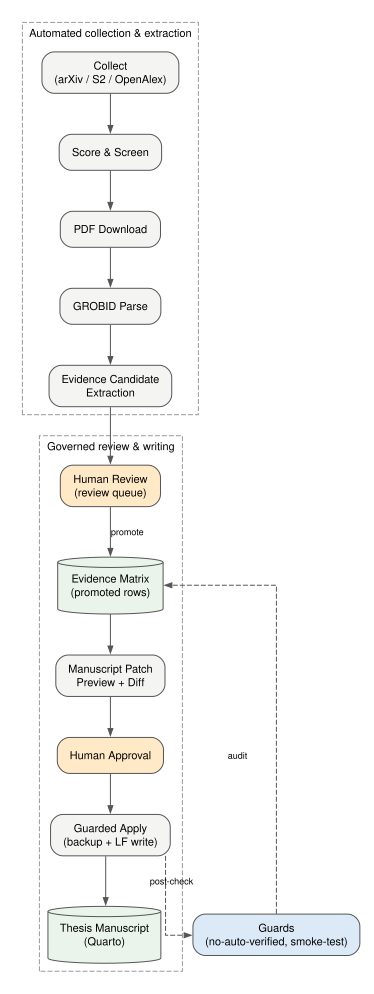
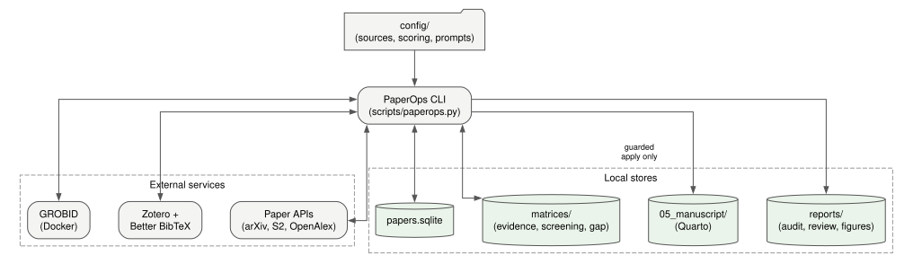
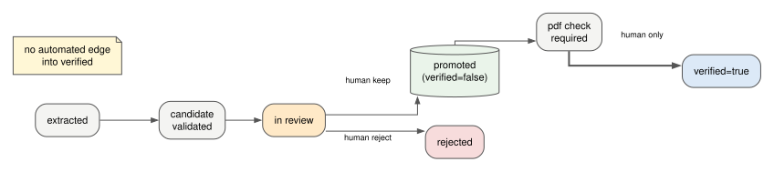
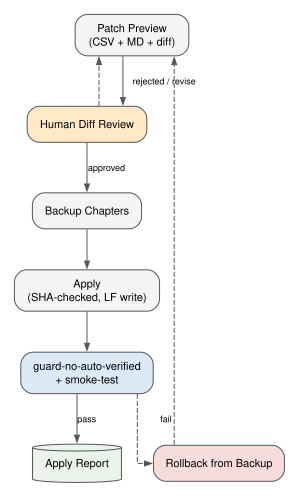

# PaperOps — نظام تشغيل للبحث وكتابة الأطروحات قائم على الأدلة أولاً

<details align="right">
  <summary>🌐 Language Translation / اختيار اللغة</summary>
  <br />
  <p>
    <a href="README.md">🇬🇧 English</a> | 
    <a href="README.ko.md">🇰🇷 한국어</a> | 
    <a href="README.de.md">🇩🇪 Deutsch</a> | 
    <a href="README.es.md">🇪🇸 Español</a> | 
    <a href="README.zh.md">🇨🇳 中文</a> | 
    <a href="README.ja.md">🇯🇵 日本語</a> | 
    <a href="README.fr.md">🇫🇷 Français</a> | 
    **🇸🇦 العربية**
  </p>
</details>



يقوم PaperOps بأتمتة **دورة حياة الكتابة البحثية بأكملها** — جمع الأدبيات،
والفرز، وتحليل ملفات PDF، واستخراج الأدلة (استدلاليًا، وبمساعدة نموذج لغوي مع
تحقق حرفي من كل اقتباس)، ومزامنة المراجع، وتحرير المخطوطة بضوابط حماية،
وتوليد أشكال قابلة لإعادة الإنتاج، وتدقيق المسودات مع مطابقة رقمية آلية مع
مخرجات التجارب — عبر واجهة سطر أوامر محلية واحدة تضم **أكثر من 50 أمرًا**.

إنه *ليس* أداة لكتابة الأوراق تلقائيًا. خط الأنابيب مؤتمت، لكن ثلاث نقاط
حُكم محجوزة عمدًا للإنسان: اعتماد الأدلة، والموافقة على تعديلات المخطوطة،
وقرار `verified=true`. ولا يمكن بلوغ حالة `verified=true` إلا عبر أمر
`verify-evidence` بإقرار بشري صريح، يُسجَّل في سجل التحقق (verification
ledger) الذي يطابقه `guard-no-auto-verified` — فالتعديل اليدوي والتعديل
المؤتمت كلاهما يسقط أمام الضابط.

## دورة الحياة الكاملة، مرحلة بمرحلة

| المرحلة | المحتوى | الأوامر الرئيسية | الأتمتة |
|---|---|---|---|
| 1. الجمع | جلب الأوراق من arXiv / Semantic Scholar / OpenAlex / Crossref باستعلامات موضوعية بوليانية، مع ترويسات polite pool، وتراجع تدريجي عند 429، وإزالة التكرار عبر المصادر | `collect`, `digest` | تلقائي |
| 2. الفرز | تقييم الصلة، الغربلة حسب محاور البحث، اكتشاف الفجوات البحثية | `score`, `screen`, `gap`, `brief` | تلقائي |
| 3. الاقتناء | تنزيل ملفات PDF، إنشاء بطاقات الأوراق والمخططات | `download-pdfs`, `cards`, `outline` | تلقائي |
| 4. التحليل | PDF ← أقسام/مراجع منظّمة عبر GROBID | `parse-grobid`, `validate-grobid-artifacts` | تلقائي |
| 5. الاستخراج | استخراج مرشّحي الأدلة (ادعاء/اقتباس/صفحة) من النص المحلَّل — استدلاليًا، أو باقتراح من نموذج لغوي مع تحقق حرفي من كل اقتباس مقابل المصدر | `extract-evidence-candidates`, `extract-evidence-llm`, `validate-evidence-candidates` | تلقائي |
| 6. المراجعة | قرار قبول / تعديل / رفض لكل مرشّح | `review-evidence-candidates`, `promotion-plan` | **بوابة بشرية** |
| 7. الترقية | نقل الأدلة المعتمدة إلى مصفوفة الأدلة (`verified=false`) | `promote-evidence`, `audit-promoted-evidence` | محمي |
| 8. تحديد الصفحات | إيجاد وتسجيل صفحة PDF الدقيقة لكل اقتباس | `locate-pdf-pages`, `apply-page-metadata` | محمي |
| 9. المراجع | مزامنة مفاتيح الاستشهاد مع BibTeX المعتمد في Zotero / Better BibTeX | `sync-zotero`, `check-citekeys` | تلقائي |
| 10. الكتابة | توليد تصحيحات المخطوطة كمعاينة + diff | `manuscript-patch-preview` | تلقائي |
| 11. التطبيق | تطبيق التصحيحات المعتمدة مع نسخ احتياطي + تحقق SHA + كتابة LF | `apply-manuscript-patch` | **بوابة بشرية** |
| 12. الأشكال | أشكال Graphviz/Mermaid مبنية على مواصفات، لا بيانات مفبركة أبدًا | `propose-figures`, `render-figures`, `apply-figure-placeholder` | محمي |
| 13. تدقيق المسودة | فحص أي مسودة (docx/md/qmd): البنية، الادعاءات بلا مصادر، المبالغات، ومطابقة رقمية آلية مع ملفات مخرجات التجارب عبر `--experiment-data` | `audit-manuscript-draft` | تلقائي |
| 14. التحقق | يضع الإنسان `verified=true` بإقرار يُسجَّل في سجل التحقق؛ وتُسقط الضوابط أي صف موسوم بالتحقق بلا قيد مطابق في السجل | `verify-evidence`, `guard-no-auto-verified`, `guard-paperops-overclaim`, `smoke-test` | **بوابة بشرية** / ضابط تلقائي |

## لماذا هذا بدلاً من دردشة LLM؟

| الاهتمام | دردشة/وكيل LLM التقليدي | PaperOps |
|---|---|---|
| من أين جاءت هذه الجملة؟ | مجهول | `paper_id` + `citekey` + اقتباس + صفحة في مصفوفة الأدلة |
| صحة الاستشهادات | جهد تقريبي | مطابقة `check-citekeys` مع BibTeX المعتمد |
| تعديل المخطوطة | كتابة فوقية مباشرة | معاينة ← diff ← موافقة ← تطبيق بتحقق SHA ← نسخ احتياطي ← تدقيق لاحق |
| حالة "تم التحقق" | ضمنية | لا يضعها إلا `verify-evidence --attest`؛ وسجل التحقق + الضوابط يكشفان ما عدا ذلك |
| الأرقام في مسودتك | غير مدققة | تُطابق آليًا مع ملفات مخرجات التجارب الفعلية (`audit-manuscript-draft --experiment-data`) |
| قابلية إعادة الإنتاج | مرتبطة بالجلسة | SQLite + مصفوفات CSV + تقارير تدقيق + سجل نشاط + مصادر الأشكال |

استُخلصت أنماط التصميم من مسح لأكثر من 40 أداة بحثية مفتوحة المصدر
(PaperQA2، STORM، GPT Researcher، AI-Scientist، ASReview، gpt_academic،
منظومة Zotero، خوادم MCP — انظر `docs/03_TOOL_SYNTHESIS.md`)، وأُعيد
تركيبها حول مبدأ واحد: **لا يدخل أي ادعاء إلى المخطوطة بدون دليل قابل
للتتبع وخاضع لمراجعة بشرية.**

## البنية المعمارية



| المكوّن | الدور | التقنية |
|---|---|---|
| `scripts/paperops.py` | واجهة أوامر منسّقة لكل المراحل والضوابط | Python، بالمكتبة القياسية أولاً |
| `scripts/paperops_figures.py` | توليد أشكال مبني على مواصفات (المصادر تُحفظ دائمًا) | Graphviz + Mermaid |
| `scripts/paperops_draft_audit.py` | تدقيق المسودات: البنية، الادعاءات، مطابقة الأرقام | Python |
| `scripts/build_public_release.py` | تصدير عام بقائمة بيضاء + فحص للأسرار | Python |
| قاعدة بيانات الأوراق | بيانات وصفية، درجات، حالات قراءة | SQLite |
| مصفوفة الأدلة | ادعاء / اقتباس / صفحة / موقع المصدر / حالة المراجعة / حقول التحقق | CSV |
| المخطوطة | فصول الأطروحة، تُعدَّل فقط عبر التطبيق المحمي | Quarto (.qmd) |
| خدمات خارجية | تحليل PDF؛ المراجع المعتمدة | GROBID (Docker), Zotero + Better BibTeX |

تتدفق البيانات في اتجاه واحد مع تقرير تدقيق عند كل خطوة محمية:
**واجهات API ← قاعدة الأوراق ← PDF ← نص محلَّل ← مرشّحو أدلة ← (إنسان) ←
مصفوفة الأدلة ← معاينات التصحيح ← (إنسان) ← المخطوطة**، مع إعادة تشغيل
الضوابط بعد كل تغيير.



## البدء السريع

```bash
git clone https://github.com/SakJaeLim/paperops.git && cd paperops
python -m venv .venv   # Python 3.10+
# Windows: .venv\Scripts\activate | Unix: source .venv/bin/activate
pip install -r requirements.txt
python scripts/paperops.py init
python scripts/paperops.py status
```

ثم ضع بريدك الإلكتروني في `config/sources.yaml` (`openalex_mailto`) — فهو
يُدرج طلبات OpenAlex/Crossref ضمن "polite pool" الخاص بكل منهما؛ وبدونه
تفرض الواجهتان تقييدًا شديدًا (HTTP 429). يعمل فورًا بدون خدمات خارجية:
الجمع، التقييم، الغربلة، تدقيق المسودات، الضوابط، توليد مصادر الأشكال.
إضافات اختيارية:

| الاعتمادية | تتيح | التثبيت |
|---|---|---|
| GROBID | تحليل PDF ← نص منظّم | `docker run -d -p 8070:8070 lfoppiano/grobid:0.8.0` |
| Zotero + Better BibTeX | مزامنة المراجع المعتمدة (ملف `.bib` مُصدَّر) | zotero.org + إضافة Better BibTeX |
| Graphviz / Mermaid CLI | إخراج الأشكال SVG/PNG (المصادر تُكتب دائمًا حتى بدونهما) | graphviz.org/download |
| مفتاح Semantic Scholar API | جمع موثوق من S2 (الوصول غير الموثَّق إلى S2 يخضع لتقييد شديد) | `semantic_scholar_api_key` في `config/sources.yaml` |
| `OPENAI_API_KEY` | `extract-evidence-llm` (استخراج محمي بنموذج لغوي مع تحقق حرفي؛ أي نقطة نهاية متوافقة مع OpenAI عبر `OPENAI_BASE_URL`) | متغيّر بيئة |

## جلسة نموذجية

```bash
# الجمع والفرز
python scripts/paperops.py collect --limit 20
python scripts/paperops.py score && python scripts/paperops.py screen --limit 80

# التحليل واستخراج الأدلة
python scripts/paperops.py download-pdfs --limit 10
python scripts/paperops.py parse-grobid --paper-id <id> --apply
python scripts/paperops.py extract-evidence-candidates --paper-id <id> --apply

# مراجعة بشرية ثم ترقية محمية
python scripts/paperops.py review-evidence-candidates --paper-id <id>
python scripts/paperops.py promote-evidence --paper-id <id> --apply

# كتابة المخطوطة بضوابط
python scripts/paperops.py manuscript-patch-preview
python scripts/paperops.py apply-manuscript-patch --from-preview <preview.csv> --dry-run
python scripts/paperops.py apply-manuscript-patch --from-preview <preview.csv> --apply

# تدقيق مسودتك (docx/md/qmd) — البنية، الادعاءات بلا مصادر، المبالغات،
# ومطابقة رقمية آلية مع ملفات مخرجات تجاربك
python scripts/paperops.py audit-manuscript-draft --input my_thesis_draft.docx --experiment-data data/experiment_outputs

# التحقق البشري (البوابة الحاسمة) — يُسجَّل في سجل التحقق
python scripts/paperops.py verify-evidence --evidence-id ev_xxxx --by "اسمك" --note "روجعت الصفحة 3 من المصدر" --attest

# الأشكال والفحوص النهائية
python scripts/paperops.py render-figures
python scripts/paperops.py guard-no-auto-verified --promoted-only
python scripts/paperops.py smoke-test
```



## تدقيق المسودة عمليًا

طُبّق `audit-manuscript-draft` على مخطوطة KCI حقيقية (413 فقرة):
فحص 378 جملة، وتدقيق بنية الفصول، ووضع علامات على الادعاءات القوية بلا
مصادر وعبارات المبالغة، ومطابقة **جميع القيم الرقمية الـ 178** في المسودة
مع ملفات مخرجات التجارب الفعلية — صفر تعارض، مع تفسير فرقين في التقريب
وإعادة حساب معدل أساس واحد من سجلات التنبؤ الخام. (كانت تلك المطابقة يدوية
حينذاك؛ ومنذ الإصدار v0.2.0 ينفّذها خيار `--experiment-data` تلقائيًا: تطابق
تام، أو تطابق بعد التقريب، أو غير موجود في البيانات، لكل رقم على حدة.)
التدقيق لا يعدّل المسودة أبدًا ولا يضع حالة تحقق؛ بل ينتج تقرير نتائج
(MD + CSV) للمؤلف فقط.

## قواعد الحوكمة

1. لا تُعدَّل مصفوفة الأدلة باستخفاف أبدًا؛ وكل عمليات إعادة الكتابة ذرّية
   (ملف مؤقت + إعادة تسمية) مع نسخ احتياطية موسومة بالوقت.
2. لا يُوضع `verified=true` تلقائيًا أبدًا. المسار الوحيد المُجاز هو
   `verify-evidence --attest`، الذي يسجّل مَن ومتى وكيف في
   `matrices/verification_ledger.csv`؛ ويُسقط `guard-no-auto-verified` أي
   صف موسوم بالتحقق بلا إقرار مطابق في السجل.
3. يخضع المرشّحون المستخرَجون بنموذج لغوي لتحقق حرفي مقابل النص المصدر
   المحلَّل — فتُستبعد الاقتباسات المُعاد صياغتها أو المختلقة ويُبلَّغ عنها —
   ثم يمرون عبر بوابات المراجعة البشرية نفسها التي يمر بها المرشّحون
   الاستدلاليون.
4. مطابقة الاقتباس/الصفحة هي *محاذاة مصدر* وليست تحققًا من الحقيقة.
5. تعديلات المخطوطة تتم فقط عبر معاينة/تطبيق محميين مع نسخ احتياطية (تُحفظ
   خارج الشجرة المحمية)، وتحقق SHA-256، وضابط + اختبار دخان بعد التطبيق؛
   وتُطابَق تقارير الموافقة مع SHA-256 للمخطوطة الحالية، فتُرفض التقارير
   القديمة أو المفبركة.
6. تُذكر نتائج الأعمال ذات الصلة كأنماط تصميم فقط، ولا تُقدَّم أبدًا
   كدليل على أداء PaperOps نفسه.

## ما لا يتضمنه هذا المستودع

الكود والإعدادات ووثائق التصميم ومصادر الأشكال المولّدة فقط. استُبعدت
عمدًا — لأسباب تتعلق بحقوق النشر ولأن قاعدة أدلتك يجب أن تُبنى من أدبياتك
الخاصة — ملفات PDF المجمّعة، والنصوص الكاملة المحلَّلة، ومصفوفات الأدلة
المتضمنة اقتباسات، وفصول المخطوطة الشخصية. التصدير يعتمد قائمة بيضاء
ويخضع لفحص الأسرار/البيانات الشخصية قبل كل إصدار
(`scripts/build_public_release.py`).

## حدود صريحة

- لا يضمن مستخرِج النموذج اللغوي سوى حرفية الاقتباسات؛ أما جودة *انتقاء*
  الادعاء/الاقتباس فتبقى رهنًا بالنموذج، ويظل كل مرشّح خاضعًا لمراجعة بشرية.
- تدقيق المسودات وضع علامات استدلالي لمراجعة بشرية، وليس تحققًا من الحقيقة؛
  والمطابقة الرقمية تتأكد من ورود الأرقام في ملفات بياناتك، لا من صحة
  التحليل نفسه.
- محاذاة الاقتباس/الصفحة لا تتحقق من صحة الادعاء — بحكم التصميم.
- لا تُولَّد أشكال نتائج كمية أبدًا بدون ملف بيانات حقيقي.
- الجمع من Semantic Scholar بدون توثيق يخضع لتقييد معدل من S2؛ ومفتاح API
  مجاني مطلوب عمليًا لهذا المصدر.
- سجل التحقق يردع التحقق الآلي العَرَضي والمتساهل؛ لكنه ليس آلية تعمية ولا
  يمنع شخصًا مصمّمًا على تزوير الإقرارات داخل ملفاته المحلية.
- قد تتأخر ملفات README غير الإنجليزية عن نظيرتها الإنجليزية بإصدار واحد؛
  والمرجع المعتمد هو README الإنجليزي وملف CHANGELOG.

## الترخيص

MIT — انظر [LICENSE](LICENSE).
