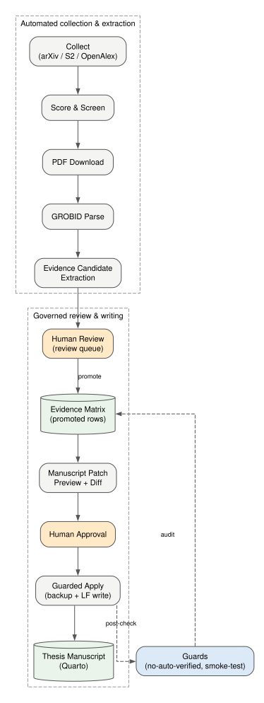
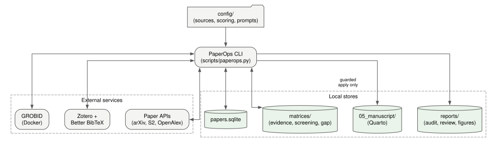
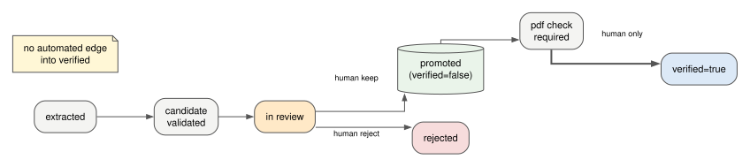
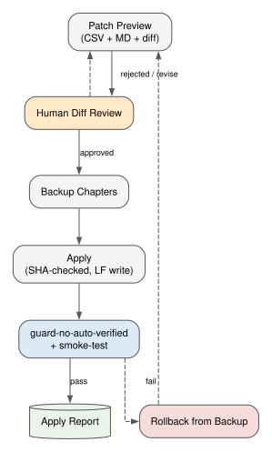

# PaperOps — Evidenzbasierte Forschungs- & Abschlussarbeits-Betriebssystem

<details align="right">
  <summary>🌐 Language Translation / Sprachauswahl</summary>
  <br />
  <p>
    <a href="README.md">🇬🇧 English</a> | 
    <a href="README.ko.md">🇰🇷 한국어</a> | 
    **🇩🇪 Deutsch** | 
    <a href="README.es.md">🇪🇸 Español</a> | 
    <a href="README.zh.md">🇨🇳 中文</a> | 
    <a href="README.ja.md">🇯🇵 日本語</a> | 
    <a href="README.fr.md">🇫🇷 Français</a> | 
    <a href="README.ar.md">🇸🇦 العربية</a>
  </p>
</details>



PaperOps automatisiert den **gesamten Forschungs- und Schreibprozess** — Literaturerfassung, Relevanzprüfung, PDF-Parsing, Evidenzextraktion (heuristisch und LLM-gestützt mit wörtlicher Zitatprüfung), Bibliographie-Synchronisation, kontrollierte Manuskriptbearbeitung, reproduzierbare Grafikerstellung und Entwurfsprüfung mit numerischem Abgleich gegen die Ausgabedateien der Experimente — über ein einziges, lokal orientiertes CLI mit **über 50 Befehlen**.

Es ist *kein* automatischer Artikelschreiber. Die Pipeline ist automatisiert, aber drei Entscheidungsschritte sind bewusst dem Menschen vorbehalten: Evidenzübernahme, Freigabe von Manuskriptänderungen und die Einstufung als `verified=true`. Der Zustand `verified=true` kann ausschließlich über den Befehl `verify-evidence` mit einer ausdrücklichen menschlichen Bestätigung (Attestation) erreicht werden; diese wird in einem Verifizierungsregister (verification ledger) festgehalten, das `guard-no-auto-verified` gegenprüft — sowohl von Hand vorgenommene als auch automatisierte Änderungen scheitern am Guard.

## Der gesamte Lebenszyklus, Schritt für Schritt

| Phase | Beschreibung | Hauptbefehle | Automatisierung |
|---|---|---|---|
| 1. Erfassen | Abrufen von Artikeln aus arXiv / Semantic Scholar / OpenAlex / Crossref über boolesche Themenabfragen — mit Polite-Pool-Headern, 429-Backoff und quellenübergreifender Dublettenbereinigung | `collect`, `digest` | Automatisch |
| 2. Selektieren | Bewerten der Relevanz, Filtern nach Forschungsachsen, Erkennen von Lücken | `score`, `screen`, `gap`, `brief` | Automatisch |
| 3. Sichern | PDFs herunterladen, Literaturkarten und Manuskriptgliederung erstellen | `download-pdfs`, `cards`, `outline` | Automatisch |
| 4. Parsen | PDF → strukturierte Abschnitte/Referenzen via GROBID konvertieren | `parse-grobid`, `validate-grobid-artifacts` | Automatisch |
| 5. Extrahieren | Thesen/Zitate/Seitenzahlen als Evidenzkandidaten aus dem geparsten Text extrahieren — heuristisch oder von einem LLM vorgeschlagen, wobei jedes Zitat wörtlich gegen die Quelle geprüft wird | `extract-evidence-candidates`, `extract-evidence-llm`, `validate-evidence-candidates` | Automatisch |
| 6. Prüfen | Entscheiden, ob jeder Kandidat übernommen, überarbeitet oder verworfen wird | `review-evidence-candidates`, `promotion-plan` | **Menschliche Freigabe** |
| 7. Befördern | Übertragen freigegebener Evidenzen in die Evidenzmatrix (`verified=false`) | `promote-evidence`, `audit-promoted-evidence` | Kontrolliert |
| 8. Verorten | Genaue PDF-Seitenzahlen für jedes Zitat ermitteln und verknüpfen | `locate-pdf-pages`, `apply-page-metadata` | Kontrolliert |
| 9. Bibliographie | Zitiercodes mit Zotero / Better BibTeX synchronisieren | `sync-zotero`, `check-citekeys` | Automatisch |
| 10. Schreiben | Manuskript-Patches als Vorschau mit Git-Diff erzeugen | `manuscript-patch-preview` | Automatisch |
| 11. Anwenden | Patches mit Backup, SHA-Prüfung und physischem Schreiben anwenden | `apply-manuscript-patch` | **Menschliche Freigabe** |
| 12. Abbildungen | Spezifikationsgestützte Figuren über Graphviz/Mermaid ohne Datenfälschung erstellen | `propose-figures`, `render-figures`, `apply-figure-placeholder` | Kontrolliert |
| 13. Auditieren | Entwürfe (docx/md/qmd) prüfen: Struktur, unbelegte Thesen, übertriebene Formulierungen und automatischer numerischer Abgleich mit den Experiment-Ausgabedateien (`--experiment-data`) | `audit-manuscript-draft` | Automatisch |
| 14. Verifizieren | Der Mensch setzt `verified=true` mit einer Bestätigung, die im Verifizierungsregister festgehalten wird; Guards lassen jede verifizierte Zeile ohne passenden Registereintrag durchfallen | `verify-evidence`, `guard-no-auto-verified`, `guard-paperops-overclaim`, `smoke-test` | **Menschliche Freigabe** / automatischer Guard |

## Warum dieses System statt eines KI-Chats?

| Herausforderung | Klassischer KI-Chat / Agent | PaperOps |
|---|---|---|
| Woher stammt dieser Satz? | Unbekannt | `paper_id` + `citekey` + Zitat + Seite in der Evidenzmatrix |
| Korrektheit der Zitate | Best-Effort | Abgeglichen mit realer Bibliographie via `check-citekeys` |
| Manuskript-Änderungen | Direkte Überschreibung | Vorschau ➔ Diff ➔ Freigabe ➔ SHA-verifizierter Apply ➔ Backup ➔ Post-Audit |
| Status "Verifiziert" | Implizit | Nur `verify-evidence --attest` kann ihn setzen; das Verifizierungsregister und die Guards decken alles andere auf |
| Zahlen im Manuskript | Ungeprüft | Abgeglichen mit den tatsächlichen Ausgabedateien der Experimente (`audit-manuscript-draft --experiment-data`) |
| Reproduzierbarkeit | Sitzungsgebunden | SQLite + CSV-Matrizen + Audit-Berichte + Aktivitätsprotokoll + Grafikquellen |

Die Entwurfsmuster wurden aus der Analyse von über 40 Open-Source-Forschungstools (PaperQA2, STORM, GPT Researcher, AI-Scientist, ASReview, gpt_academic, Zotero-Ökosystem, MCP-Server — siehe `docs/03_TOOL_SYNTHESIS.md`) abgeleitet und unter einem Leitprinzip neu zusammengesetzt: **Keine Behauptung gelangt ohne nachvollziehbare, von Menschen geprüfte Belege in das Manuskript.**

## Architektur



| Komponente | Rolle | Technologie |
|---|---|---|
| `scripts/paperops.py` | Haupt-CLI: koordiniert alle Pipeline-Stufen und Guards | Python |
| `scripts/paperops_figures.py` | Spezifikationsgestützte Grafikgenerierung (Quellcode wird immer gesichert) | Graphviz + Mermaid |
| `scripts/paperops_draft_audit.py` | Entwurfsprüfung: Struktur, Belege und Abgleich numerischer Angaben | Python |
| `scripts/build_public_release.py` | Whitelist-basierter öffentlicher Export mit Secret- & PII-Scanner | Python |
| Literatur-DB | Datenbank für Metadaten der gesammelten Artikel und Lesestände | SQLite |
| Evidenzmatrix | These / Originalzitat / Seitenzahl / Fundort / Prüfstatus | CSV |
| Manuskript | Kapitel der Abschlussarbeit, Änderungen nur via kontrolliertem Apply | Quarto (.qmd) |
| Externe Dienste | PDF-Parsing; bibliographische Hauptdatenbank | GROBID (Docker), Zotero + Better BibTeX |

Die Daten fließen in einer einzigen Richtung mit Audit-Berichten bei jedem kontrollierten Schritt:
**APIs → Literatur-DB → PDFs → Text-Parsing → Evidenzkandidaten → (Mensch) → Evidenzmatrix → Patch-Vorschau → (Mensch) → Manuskript**, gefolgt von einer automatischen erneuten Ausführung der Validierungs-Guards.



## Schnellstart

```bash
git clone https://github.com/SakJaeLim/paperops.git && cd paperops
python -m venv .venv   # Python 3.10+
# Unter Windows: .venv\Scripts\activate | Unter Unix: source .venv/bin/activate
pip install -r requirements.txt
python scripts/paperops.py init
python scripts/paperops.py status
```

Tragen Sie anschließend Ihre E-Mail-Adresse in `config/sources.yaml` (`openalex_mailto`) ein — damit landen Anfragen an OpenAlex/Crossref in deren Polite Pool; ohne sie drosseln beide APIs stark (HTTP 429). Funktioniert sofort ohne externe Dienste für: Erfassung, Bewertung, Selektion, Entwurfsprüfung, Guards und Grafikquellengenerierung. Optionale Erweiterungen:

| Abhängigkeit | Ermöglicht | Installation |
|---|---|---|
| GROBID | PDF-Parsing zu strukturiertem Text | `docker run -d -p 8070:8070 lfoppiano/grobid:0.8.0` |
| Zotero + Better BibTeX | Synchronisation mit der Referenz-Bibliographie (exportierte `.bib`-Datei) | zotero.org + Better BibTeX Plugin installieren |
| Graphviz / Mermaid CLI | Rendering von SVG/PNG-Grafiken (die Quellen werden auch ohne sie immer geschrieben) | Herunterladen über graphviz.org |
| Semantic Scholar API-Schlüssel | Zuverlässige S2-Erfassung (ohne Authentifizierung drosselt S2 stark) | `semantic_scholar_api_key` in `config/sources.yaml` |
| `OPENAI_API_KEY` | `extract-evidence-llm` (kontrollierte LLM-Extraktion mit wörtlicher Zitatprüfung; jeder OpenAI-kompatible Endpunkt via `OPENAI_BASE_URL`) | Umgebungsvariable |

## Typischer Ablauf

```bash
# Erfassen und Selektieren
python scripts/paperops.py collect --limit 20
python scripts/paperops.py score && python scripts/paperops.py screen --limit 80

# PDFs parsen und Evidenz extrahieren
python scripts/paperops.py download-pdfs --limit 10
python scripts/paperops.py parse-grobid --paper-id <id> --apply
python scripts/paperops.py extract-evidence-candidates --paper-id <id> --apply

# Menschliche Prüfung und Beförderung
python scripts/paperops.py review-evidence-candidates --paper-id <id>
python scripts/paperops.py promote-evidence --paper-id <id> --apply

# Manuskript kontrolliert aktualisieren
python scripts/paperops.py manuscript-patch-preview
python scripts/paperops.py apply-manuscript-patch --from-preview <preview.csv> --dry-run
python scripts/paperops.py apply-manuscript-patch --from-preview <preview.csv> --apply

# Eigenen Entwurf auditieren (docx/md/qmd) — Struktur, unbelegte Thesen, übertriebene
# Formulierungen und automatischer numerischer Abgleich mit den Ausgabedateien der Experimente
python scripts/paperops.py audit-manuscript-draft --input mein_entwurf.docx --experiment-data data/experiment_outputs

# Menschliche Verifizierung (DAS Tor) — im Verifizierungsregister festgehalten
python scripts/paperops.py verify-evidence --evidence-id ev_xxxx --by "Ihr Name" --note "S. 3 geprüft" --attest

# Figuren rendern und Abschlussprüfungen
python scripts/paperops.py render-figures
python scripts/paperops.py guard-no-auto-verified --promoted-only
python scripts/paperops.py smoke-test
```



## Praxisbeispiel der Entwurfsprüfung

Der Befehl `audit-manuscript-draft` wurde auf ein echtes KCI-Manuskript (413 Absätze) angewendet: Er scannte 378 Sätze, überprüfte die Kapitelstruktur, markierte unbelegte starke Thesen und übertriebene Formulierungen, und **alle 178 numerischen Werte** im Entwurf wurden mit den tatsächlichen Experiment-Ausgabedateien abgeglichen — 0 Diskrepanzen, wobei 2 Rundungsdifferenzen dokumentiert und 1 Basisrate aus den Rohprotokollen neu berechnet wurde. (Dieser Abgleich erfolgte damals von Hand; seit v0.2.0 führt ihn die Option `--experiment-data` automatisch durch und meldet pro Zahl exakte Übereinstimmung, Rundungsübereinstimmung oder „in den Daten nicht gefunden“.)

## Governance-Regeln

1. Die Evidenzmatrix wird niemals unbedacht geändert; alle Neuschreibungen erfolgen atomar (temporäre Datei + Umbenennen) und werden von zeitgestempelten Backups begleitet.
2. `verified=true` wird niemals automatisch gesetzt. Der einzige zulässige Weg ist `verify-evidence --attest`, das Wer/Wann/Wie in `matrices/verification_ledger.csv` festhält; `guard-no-auto-verified` lässt jede verifizierte Zeile ohne passende Bestätigung im Register durchfallen.
3. Von einem LLM extrahierte Kandidaten werden wörtlich gegen den geparsten Quelltext geprüft — umformulierte oder erfundene Zitate werden verworfen und gemeldet — und durchlaufen anschließend dieselben menschlichen Prüfschritte wie heuristische Kandidaten.
4. Der Abgleich von Zitat/Seite dient der *Quellenverortung*, nicht der absoluten Wahrheitsprüfung.
5. Manuskript-Änderungen erfolgen ausschließlich über den kontrollierten Preview/Apply-Prozess mit Backups (außerhalb des kontrollierten Verzeichnisbaums gespeichert), SHA-256-Prüfungen sowie Post-Apply-Guard und Smoke-Test; Freigabeberichte werden gegen die aktuelle SHA-256-Summe des Manuskripts abgeglichen, sodass veraltete oder gefälschte Berichte abgelehnt werden.
6. Ergebnisse verwandter Arbeiten werden als Design-Patterns dargestellt, niemals als Leistungsbelege für PaperOps selbst.

## Was dieses Repository NICHT enthält

Ausschließlich Code, Konfigurationen, Design-Dokumente und generierte Grafikquellen. Es schließt gesammelte PDF-Artikel, geparste Volltexte, Evidenzmatrizen mit Rohzitaten und persönliche Manuskriptkapitel bewusst aus — aus Urheberrechtsgründen und weil Ihre Evidenzbasis aus Ihrer eigenen Literaturrecherche aufgebaut werden sollte.

## Ehrliche Einschränkungen

- Der LLM-Extraktor garantiert lediglich, dass die Zitate wörtlich sind; die Qualität der *Auswahl* von These und Zitat hängt weiterhin vom Modell ab, und jeder Kandidat erfordert nach wie vor eine menschliche Prüfung.
- Die Entwurfsprüfung ist eine heuristische Kennzeichnung für die menschliche Durchsicht, keine absolute Wahrheitsprüfung; der numerische Abgleich bestätigt nur, dass die Zahlen in Ihren Datendateien vorkommen, nicht dass die Auswertung korrekt ist.
- Die Verortung von Zitat und Seite validiert konstruktionsbedingt nicht den Wahrheitsgehalt einer Behauptung.
- Quantitative Grafiken werden niemals ohne eine reale Datendatei generiert.
- Die Erfassung über Semantic Scholar ohne Authentifizierung wird von S2 stark gedrosselt; für diese Quelle ist ein kostenloser API-Schlüssel faktisch erforderlich.
- Das Verifizierungsregister schützt vor versehentlicher und beiläufiger automatisierter Verifizierung; es ist nicht kryptographisch abgesichert und kann einen entschlossenen Menschen nicht daran hindern, Bestätigungen in seinen eigenen lokalen Dateien zu fälschen.
- Die nicht-englischen READMEs können der englischen Fassung um eine Release-Version hinterherhinken; maßgeblich sind das englische README und der CHANGELOG.

## Lizenz

MIT — siehe [LICENSE](LICENSE).
