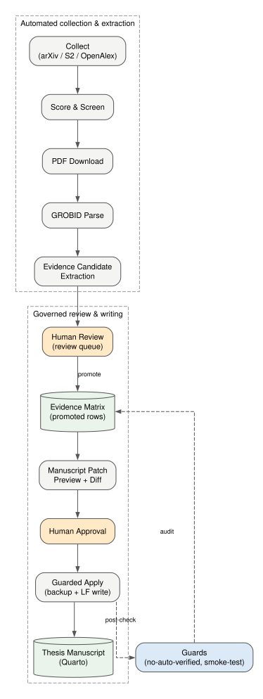
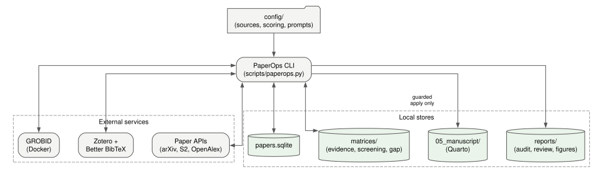
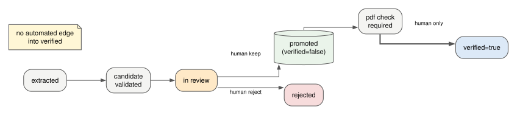
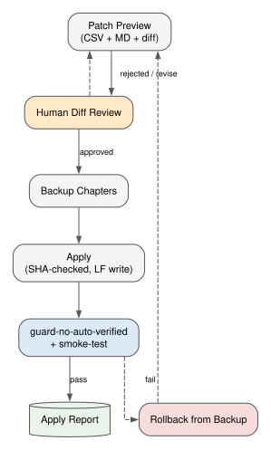

# PaperOps — エビデンス・ファーストの研究・論文執筆OS

<details align="right">
  <summary>🌐 Language Translation / 言語選択</summary>
  <br />
  <p>
    <a href="README.md">🇬🇧 English</a> | 
    <a href="README.ko.md">🇰🇷 한국어</a> | 
    <a href="README.de.md">🇩🇪 Deutsch</a> | 
    <a href="README.es.md">🇪🇸 Español</a> | 
    <a href="README.zh.md">🇨🇳 中文</a> | 
    **🇯🇵 日本語** | 
    <a href="README.fr.md">🇫🇷 Français</a> | 
    <a href="README.ar.md">🇸🇦 العربية</a>
  </p>
</details>



PaperOps は**研究執筆のライフサイクル全体** — 文献収集、スクリーニング、
PDF 解析、エビデンス抽出(ヒューリスティック、および引用の逐語チェックを伴う
LLM 支援)、文献管理同期、ガード付き原稿編集、再現可能な図表生成、実験出力
との数値自動照合を伴うドラフト監査 — を、**50 以上のコマンド**を持つ
ローカルファースト CLI ひとつで自動化します。

論文を*代筆する*ツールではありません。パイプラインは自動ですが、判断を要する
3 つのポイント — エビデンスの採用、原稿修正の承認、`verified=true` の判定 —
は意図的に人間に残されています。`verified=true` の状態に入れるのは、明示的な
人間の確約(attestation)を伴う `verify-evidence` コマンドだけです。確約は
検証台帳(verification ledger)に記録され、`guard-no-auto-verified` がそれを
照合します — 手作業による編集も自動化による編集も、ともにガードで失敗します。

## ライフサイクル全体(ステージ別)

| ステージ | 内容 | 主要コマンド | 自動化 |
|---|---|---|---|
| 1. 収集 | arXiv / Semantic Scholar / OpenAlex / Crossref からブーリアン・トピッククエリで取得 — polite pool ヘッダー、429 バックオフ、ソース間の重複排除つき | `collect`, `digest` | 自動 |
| 2. 選別 | 関連度スコアリング、研究軸別スクリーニング、研究ギャップ発見 | `score`, `screen`, `gap`, `brief` | 自動 |
| 3. 取得 | PDF ダウンロード、論文カード・アウトライン生成 | `download-pdfs`, `cards`, `outline` | 自動 |
| 4. 解析 | GROBID で PDF → 構造化セクション/参考文献 | `parse-grobid`, `validate-grobid-artifacts` | 自動 |
| 5. 抽出 | 解析テキストから主張/引用/ページのエビデンス候補を抽出 — ヒューリスティック、またはすべての引用を出典と逐語照合する LLM 提案 | `extract-evidence-candidates`, `extract-evidence-llm`, `validate-evidence-candidates` | 自動 |
| 6. レビュー | 候補ごとに採用/修正/却下を決定 | `review-evidence-candidates`, `promotion-plan` | **人間のゲート** |
| 7. 昇格 | 承認済みエビデンスを Evidence Matrix へ移動(`verified=false`) | `promote-evidence`, `audit-promoted-evidence` | ガード付き |
| 8. ページ特定 | 各引用の正確な PDF ページを特定・記録 | `locate-pdf-pages`, `apply-page-metadata` | ガード付き |
| 9. 文献管理 | Zotero / Better BibTeX の正準 BibTeX と citekey を同期 | `sync-zotero`, `check-citekeys` | 自動 |
| 10. 執筆 | 原稿パッチを preview + diff として生成 | `manuscript-patch-preview` | 自動 |
| 11. 適用 | 承認済みパッチをバックアップ + SHA 検証 + LF 書込で適用 | `apply-manuscript-patch` | **人間のゲート** |
| 12. 図表 | 仕様駆動の Graphviz/Mermaid 図、データ捏造禁止 | `propose-figures`, `render-figures`, `apply-figure-placeholder` | ガード付き |
| 13. ドラフト監査 | 任意の草稿(docx/md/qmd)を検査:構造、出典なし主張、誇張、および `--experiment-data` による実験出力ファイルとの数値自動照合 | `audit-manuscript-draft` | 自動 |
| 14. 検証 | 人間が確約とともに `verified=true` を設定し、検証台帳に記録する。台帳に対応する記録のない verified 行はガードが失敗させる | `verify-evidence`, `guard-no-auto-verified`, `guard-paperops-overclaim`, `smoke-test` | **人間のゲート** / 自動ガード |

## チャット LLM ではなくこれを使う理由

| 関心事 | 一般的な LLM チャット/エージェント | PaperOps |
|---|---|---|
| この文の出典は? | 不明 | Evidence Matrix の `paper_id` + `citekey` + 引用 + ページ |
| 引用の正確性 | ベストエフォート | 正準 BibTeX と `check-citekeys` で照合 |
| 原稿編集 | 直接上書き | preview → diff → 承認 → SHA 検証適用 → バックアップ → 事後監査 |
| 「検証済み」状態 | 暗黙的 | `verify-evidence --attest` でのみ設定可能;検証台帳 + ガードがそれ以外をすべて検出 |
| 草稿内の数値 | 未確認 | 実際の実験出力ファイルと自動照合(`audit-manuscript-draft --experiment-data`) |
| 再現性 | セッション限り | SQLite + CSV マトリクス + 監査レポート + 活動ログ + 図表ソース |

40 以上のオープンソース研究ツール(PaperQA2、STORM、GPT Researcher、
AI-Scientist、ASReview、gpt_academic、Zotero エコシステム、MCP サーバー —
`docs/03_TOOL_SYNTHESIS.md` 参照)の設計パターンを調査し、**「追跡可能で
人間がレビューしたエビデンスなしに、いかなる主張も原稿に入れない」**という
一原則のもとに再構成しました。

## アーキテクチャ



| コンポーネント | 役割 | 技術 |
|---|---|---|
| `scripts/paperops.py` | 全ステージとガードを統括するオーケストレーター CLI | Python、標準ライブラリ優先 |
| `scripts/paperops_figures.py` | 仕様駆動の図表生成(ソースを常に保存) | Graphviz + Mermaid |
| `scripts/paperops_draft_audit.py` | ドラフト監査:構造、主張、数値照合 | Python |
| `scripts/build_public_release.py` | ホワイトリスト式公開エクスポート + 機密スキャン | Python |
| 論文 DB | 論文メタデータ、スコア、読書状態 | SQLite |
| Evidence Matrix | 主張/引用/ページ/出典位置/レビュー状態/検証フィールド | CSV(diff フレンドリー) |
| 原稿 | 論文チャプター、ガード付き apply のみで修正 | Quarto (.qmd) |
| 外部サービス | PDF 解析、正準文献管理 | GROBID (Docker), Zotero + Better BibTeX |

データは一方向に流れ、ガード付き各ステップで監査レポートが生成されます:
**API → 論文 DB → PDF → 解析テキスト → エビデンス候補 → (人間) →
Evidence Matrix → パッチ preview → (人間) → 原稿**、変更のたびにガードを再実行。



## クイックスタート

```bash
git clone https://github.com/SakJaeLim/paperops.git && cd paperops
python -m venv .venv   # Python 3.10+
# Windows: .venv\Scripts\activate | Unix: source .venv/bin/activate
pip install -r requirements.txt
python scripts/paperops.py init
python scripts/paperops.py status
```

続いて `config/sources.yaml` の `openalex_mailto` に自分のメールアドレスを
設定してください — OpenAlex/Crossref へのリクエストが polite pool に入ります。
設定しないと両 API とも強くスロットリングされます(HTTP 429)。外部サービス
なしで即動作:収集、スコアリング、スクリーニング、ドラフト監査、ガード、
図表ソース生成。オプションの追加コンポーネント:

| 依存 | 有効になる機能 | インストール |
|---|---|---|
| GROBID | PDF → 構造化テキスト解析 | `docker run -d -p 8070:8070 lfoppiano/grobid:0.8.0` |
| Zotero + Better BibTeX | 正準文献管理の同期(エクスポートした `.bib` ファイル) | zotero.org + Better BibTeX プラグイン |
| Graphviz / Mermaid CLI | SVG/PNG 図表レンダリング(なくてもソースは常に出力される) | graphviz.org/download |
| Semantic Scholar API キー | 安定した S2 収集(未認証の S2 はレート制限が強い) | `config/sources.yaml` の `semantic_scholar_api_key` |
| `OPENAI_API_KEY` | `extract-evidence-llm`(ガード付き・逐語チェック付きの LLM 抽出;`OPENAI_BASE_URL` で OpenAI 互換エンドポイントも利用可) | 環境変数 |

## 典型的なセッション

```bash
# 収集と選別
python scripts/paperops.py collect --limit 20
python scripts/paperops.py score && python scripts/paperops.py screen --limit 80

# 解析とエビデンス抽出
python scripts/paperops.py download-pdfs --limit 10
python scripts/paperops.py parse-grobid --paper-id <id> --apply
python scripts/paperops.py extract-evidence-candidates --paper-id <id> --apply

# 人間のレビュー後、ガード付き昇格
python scripts/paperops.py review-evidence-candidates --paper-id <id>
python scripts/paperops.py promote-evidence --paper-id <id> --apply

# ガード付き原稿執筆
python scripts/paperops.py manuscript-patch-preview
python scripts/paperops.py apply-manuscript-patch --from-preview <preview.csv> --dry-run
python scripts/paperops.py apply-manuscript-patch --from-preview <preview.csv> --apply

# 自分のドラフトを監査(docx/md/qmd)— 構造、出典なし主張、誇張、
# および実験出力ファイルとの数値自動照合
python scripts/paperops.py audit-manuscript-draft --input my_thesis_draft.docx --experiment-data data/experiment_outputs

# 人間による検証(核心のゲート)— 検証台帳に記録される
python scripts/paperops.py verify-evidence --evidence-id ev_xxxx --by "氏名" --note "原文 p.3 確認" --attest

# 図表と最終チェック
python scripts/paperops.py render-figures
python scripts/paperops.py guard-no-auto-verified --promoted-only
python scripts/paperops.py smoke-test
```



## ドラフト監査の実例

`audit-manuscript-draft` を実際の KCI 投稿原稿(413 段落)に適用:
378 文をスキャンし、章構造を点検し、出典のない強い主張と誇張表現をフラグし、
草稿内の 178 個の数値すべてを実際の実験出力ファイルと照合 — 不一致 0 件、
丸め誤差 2 件は説明済み、ベースレート 1 件は生の予測ログから再計算して確認。
(当時この照合は手作業でした。v0.2.0 以降は `--experiment-data` フラグが、
数値ごとに「完全一致 / 丸め一致 / データ内に見つからず」を自動判定します。)
監査はドラフトを決して修正せず、verified 状態も作りません。著者のための
発見レポート(MD + CSV)のみを生成します。

## ガバナンスルール

1. Evidence Matrix をみだりに変更しない。書き換えはすべてアトミック
   (一時ファイル + リネーム)で、タイムスタンプ付きバックアップを伴う。
2. `verified=true` は決して自動設定されない。許された唯一の経路は
   `verify-evidence --attest` であり、誰が/いつ/どのように行ったかが
   `matrices/verification_ledger.csv` に記録される。台帳に確約のない
   verified 行は `guard-no-auto-verified` が失敗させる。
3. LLM が抽出した候補は解析済みの出典テキストと逐語照合される — 言い換えや
   捏造された引用は破棄・報告される — うえで、ヒューリスティック候補と同じ
   人間レビューのゲートを通る。
4. 引用/ページ照合は*出典アライメント*であり、真実性の検証ではない。
5. 原稿編集は、バックアップ(ガード対象ツリーの外に保存)、SHA-256 検証、
   事後ガード + スモークテストを伴うガード付き preview/apply のみ。承認
   レポートは現在の原稿の SHA-256 と照合され、古いものや捏造されたものは
   拒否される。
6. 関連研究の知見は設計パターンとしてのみ引用し、PaperOps 自体の性能根拠と
   して誇張しない。

## このリポジトリに含まれないもの

コード、設定、設計ドキュメント、生成された図表ソースのみ。著作権上の理由と
「エビデンス基盤は各自の文献で構築すべき」という原則から、収集論文の PDF、
解析全文、引用入り Evidence Matrix、個人の原稿チャプターは意図的に除外。
エクスポートはホワイトリスト式で、リリース前に機密/個人情報スキャンを実施
(`scripts/build_public_release.py`)。

## 正直な限界

- LLM 抽出器が保証するのは引用が逐語であることだけ。どの主張/引用を選ぶかの
  品質は依然としてモデル次第であり、すべての候補は今も人間のレビューを要する。
- ドラフト監査は人間のレビューのためのヒューリスティックなフラグ付けであり、
  真実性の検証ではない。数値照合はその数値がデータファイルに存在するかを
  確認するだけで、分析が正しいことを検証するものではない。
- 引用/ページのアライメントは主張の真実性を検証しない — 設計上の意図。
- 実データファイルなしに定量結果の図表は決して生成しない。
- 未認証の Semantic Scholar 収集は S2 側のレート制限が強く、そのソースには
  無料 API キーが事実上必須。
- 検証台帳は偶発的・不注意な自動検証を抑止する仕組みであり、暗号学的な保証
  ではない。自分のローカルファイル上で確約を意図的に偽造する人間までは
  止められない。
- 非英語版 README は英語版より 1 リリース遅れることがある。英語版 README と
  CHANGELOG が正典。

## ライセンス

MIT — [LICENSE](LICENSE) を参照。
