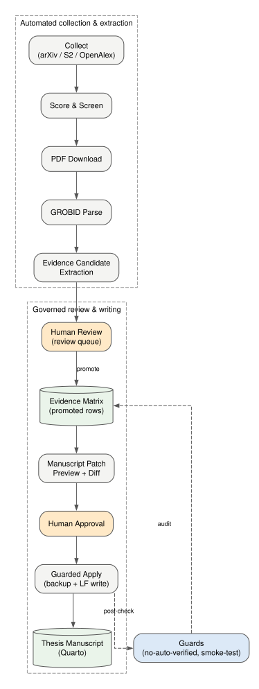
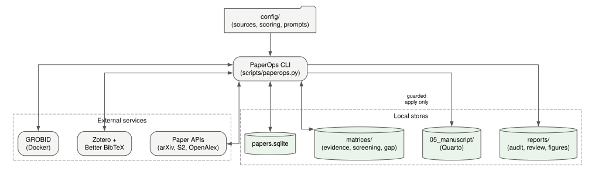
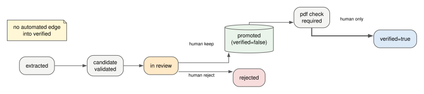
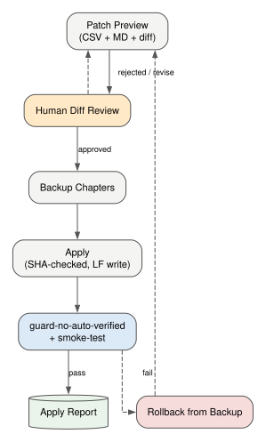

# PaperOps — Evidence-first Research & Thesis Writing OS

Try the offline portfolio walkthrough: `python scripts/demo_public.py`.
It audits synthetic claims and checks that verification still requires attestation.
No API key or private manuscript is needed. [Demo guide](docs/PUBLIC_DEMO.md).

<details align="right">
  <summary>🌐 Language Translation / Language Selection</summary>
  <br />
  <p>
    **🇬🇧 English** | 
    <a href="README.ko.md">🇰🇷 한국어</a> | 
    <a href="README.de.md">🇩🇪 Deutsch</a> | 
    <a href="README.es.md">🇪🇸 Español</a> | 
    <a href="README.zh.md">🇨🇳 中文</a> | 
    <a href="README.ja.md">🇯🇵 日本語</a> | 
    <a href="README.fr.md">🇫🇷 Français</a> | 
    <a href="README.ar.md">🇸🇦 العربية</a>
  </p>
</details>



PaperOps automates the **entire research-writing lifecycle** — literature
collection, screening, PDF parsing, evidence extraction (heuristic and
LLM-assisted with verbatim quote checking), bibliography sync, guarded
manuscript editing, reproducible figure generation, and draft auditing with
numeric cross-checks against experiment outputs — through a single
local-first CLI with **50+ commands**.

It is *not* an auto-paper-writer. The pipeline is automated, but three
judgment points are deliberately reserved for humans: evidence adoption,
manuscript-change approval, and the `verified=true` decision. The
`verified=true` state can only be entered through the `verify-evidence`
command with an explicit human attestation, recorded in a verification
ledger that `guard-no-auto-verified` cross-checks — hand edits and automated
edits both fail the guard.

## The full lifecycle, stage by stage

| Stage | What happens | Key commands | Automation |
|---|---|---|---|
| 1. Collect | Fetch papers from arXiv / Semantic Scholar / OpenAlex / Crossref with boolean topic queries, polite-pool headers, 429 backoff, and cross-source dedup | `collect`, `digest` | Automatic |
| 2. Triage | Score relevance, screen by research axes, find research gaps | `score`, `screen`, `gap`, `brief` | Automatic |
| 3. Acquire | Download PDFs, build paper cards and outlines | `download-pdfs`, `cards`, `outline` | Automatic |
| 4. Parse | PDF → structured sections/references via GROBID | `parse-grobid`, `validate-grobid-artifacts` | Automatic |
| 5. Extract | Pull claim/quote/page evidence candidates from parsed text — heuristic, or LLM-proposed with every quote verbatim-verified against the source | `extract-evidence-candidates`, `extract-evidence-llm`, `validate-evidence-candidates` | Automatic |
| 6. Review | Decide keep / revise / reject for each candidate | `review-evidence-candidates`, `promotion-plan` | **Human gate** |
| 7. Promote | Move approved evidence into the Evidence Matrix (`verified=false`) | `promote-evidence`, `audit-promoted-evidence` | Guarded |
| 8. Locate | Find and attach exact PDF pages for each quote | `locate-pdf-pages`, `apply-page-metadata` | Guarded |
| 9. Bibliography | Sync citekeys with Zotero / Better BibTeX canonical BibTeX | `sync-zotero`, `check-citekeys` | Automatic |
| 10. Write | Generate manuscript patches as preview + diff | `manuscript-patch-preview` | Automatic |
| 11. Apply | Apply approved patches with backup + SHA check + LF write | `apply-manuscript-patch` | **Human gate** |
| 12. Figures | Spec-driven Graphviz/Mermaid figures, never fabricated data | `propose-figures`, `render-figures`, `apply-figure-placeholder` | Guarded |
| 13. Audit drafts | Check any draft (docx/md/qmd): structure, unsourced claims, overclaims, and automatic numeric cross-check against experiment output files (`--experiment-data`) | `audit-manuscript-draft` | Automatic |
| 14. Verify | Human sets `verified=true` with an attestation recorded in the verification ledger; guards fail any verified row without a matching ledger entry | `verify-evidence`, `guard-no-auto-verified`, `guard-paperops-overclaim`, `smoke-test` | **Human gate** / automatic guard |

## Why this instead of a chat LLM?

| Concern | Typical LLM chat / agent | PaperOps |
|---|---|---|
| Where did this sentence come from? | unknown | `paper_id` + `citekey` + quote + page in the Evidence Matrix |
| Citation correctness | best-effort | `check-citekeys` against canonical BibTeX |
| Manuscript edits | direct overwrite | preview → diff → approval → SHA-checked apply → backup → post-audit |
| "Verified" status | implied | only `verify-evidence --attest` can set it; the verification ledger + guards catch anything else |
| Numbers in your draft | unchecked | cross-checked against actual experiment output files (`audit-manuscript-draft --experiment-data`) |
| Reproducibility | session-bound | SQLite + CSV matrices + audit reports + activity log + figure sources |

Design patterns were synthesized from a survey of 40+ open-source research
tools (PaperQA2, STORM, GPT Researcher, AI-Scientist, ASReview, gpt_academic,
Zotero ecosystems, MCP servers — see `docs/03_TOOL_SYNTHESIS.md`), re-assembled
around one principle: **no claim enters the manuscript without traceable,
human-reviewed evidence.**

## Architecture



| Component | Role | Technology |
|---|---|---|
| `scripts/paperops.py` | Orchestrator CLI: all pipeline stages and guards | Python, stdlib-first |
| `scripts/paperops_figures.py` | Spec-driven figure generation (sources always saved) | Graphviz + Mermaid |
| `scripts/paperops_draft_audit.py` | Draft auditing: structure, claims, numeric cross-check | Python |
| `scripts/build_public_release.py` | Whitelist-based public export with secret/PII scan | Python |
| Paper DB | Collected paper metadata, scores, reading states | SQLite |
| Evidence Matrix | claim / quote / page / source location / review status / verification fields | CSV (diff-friendly) |
| Manuscript | Thesis chapters, modified only via guarded apply | Quarto (.qmd) |
| External services | PDF parsing; canonical bibliography | GROBID (Docker), Zotero + Better BibTeX |

Data flows in one direction with audit reports at every guarded step:
**APIs → paper DB → PDFs → parsed text → evidence candidates → (human) →
Evidence Matrix → patch previews → (human) → manuscript**, with guards
(`guard-no-auto-verified`, `smoke-test`) re-run after every change.



## Quickstart

```bash
git clone https://github.com/SakJaeLim/paperops.git && cd paperops
python -m venv .venv   # Python 3.10+
# Windows: .venv\Scripts\activate | Unix: source .venv/bin/activate
pip install -r requirements.txt
python scripts/paperops.py init
python scripts/paperops.py status
```

Then set your email in `config/sources.yaml` (`openalex_mailto`) — it puts
OpenAlex/Crossref requests in their polite pools; without it both APIs
throttle hard (HTTP 429). Works immediately with no external services:
collection, scoring, screening, draft audit, guards, figures-as-source.
Optional add-ons:

| Dependency | Enables | Install |
|---|---|---|
| GROBID | PDF → structured text parsing | `docker run -d -p 8070:8070 lfoppiano/grobid:0.8.0` |
| Zotero + Better BibTeX | Canonical bibliography sync (exported `.bib` file) | zotero.org + Better BibTeX plugin |
| Graphviz / Mermaid CLI | SVG/PNG figure rendering (sources are always written even without them) | graphviz.org/download |
| Semantic Scholar API key | Reliable S2 collection (unauthenticated S2 rate-limits hard) | `semantic_scholar_api_key` in `config/sources.yaml` |
| `OPENAI_API_KEY` | `extract-evidence-llm` (guarded, verbatim-checked LLM extraction; any OpenAI-compatible endpoint via `OPENAI_BASE_URL`) | environment variable |

## Typical session

```bash
# Collect and triage
python scripts/paperops.py collect --limit 20
python scripts/paperops.py score && python scripts/paperops.py screen --limit 80

# Parse and extract evidence
python scripts/paperops.py download-pdfs --limit 10
python scripts/paperops.py parse-grobid --paper-id <id> --apply
python scripts/paperops.py extract-evidence-candidates --paper-id <id> --apply

# Human review, then guarded promotion
python scripts/paperops.py review-evidence-candidates --paper-id <id>
python scripts/paperops.py promote-evidence --paper-id <id> --apply

# Guarded manuscript writing
python scripts/paperops.py manuscript-patch-preview
python scripts/paperops.py apply-manuscript-patch --from-preview <preview.csv> --dry-run
python scripts/paperops.py apply-manuscript-patch --from-preview <preview.csv> --apply

# Audit your own draft (docx/md/qmd) — structure, unsourced claims, overclaims,
# and automatic numeric cross-check against your experiment output files
python scripts/paperops.py audit-manuscript-draft --input my_thesis_draft.docx --experiment-data data/experiment_outputs

# Human verification (THE gate) — recorded in the verification ledger
python scripts/paperops.py verify-evidence --evidence-id ev_xxxx --by "Your Name" --note "checked p.3" --attest

# Figures and final checks
python scripts/paperops.py render-figures
python scripts/paperops.py guard-no-auto-verified --promoted-only
python scripts/paperops.py smoke-test
```



## Draft audit in practice

`audit-manuscript-draft` was used on a real KCI manuscript (413 paragraphs):
it scanned 378 sentences, checked chapter structure, flagged unsourced strong
claims and overclaim language, and all 178 numeric values in the draft were
cross-checked against the actual experiment output files — 0 mismatches, with
2 rounding differences explained and 1 base rate re-computed from raw
prediction logs. (That cross-check was manual at the time; since v0.2.0 the
`--experiment-data` flag performs it automatically: exact match, rounding
match, and not-found-in-data statuses per number.) The audit never edits the
draft and never marks anything verified; it produces a findings report
(MD + CSV) for the author.

## Governance rules

1. The Evidence Matrix is never modified casually; all rewrites are atomic
   (temp file + rename) with timestamped backups.
2. `verified=true` is never set automatically. The only sanctioned path is
   `verify-evidence --attest`, which records who/when/how in
   `matrices/verification_ledger.csv`; `guard-no-auto-verified` fails any
   verified row without a matching ledger attestation.
3. LLM-extracted candidates are verbatim-checked against the parsed source
   text — paraphrased or invented quotes are dropped and reported — and then
   flow through the same human review gates as heuristic candidates.
4. Quote/page matching is *source alignment*, not truth validation.
5. Manuscript edits happen only through guarded preview/apply with backups
   (stored outside the guarded tree), SHA-256 checks, and post-apply guard +
   smoke-test; approval reports are cross-checked against the current
   manuscript SHA-256 so stale or fabricated reports are rejected.
6. Related-work findings are framed as design patterns, never as performance
   evidence for PaperOps itself.

## What this repo does NOT include

Code, configuration, design docs, and generated figure sources only. It
deliberately excludes collected paper PDFs, parsed full texts, evidence
matrices with quotes, and personal manuscript chapters — for copyright
reasons, and because your evidence base should be built from your own
literature. The export is whitelist-based and scanned for secrets/PII before
every release (`scripts/build_public_release.py`).

## Honest limitations

- The LLM extractor only guarantees quotes are verbatim; claim/quote
  *selection* quality still depends on the model, and every candidate still
  requires human review.
- Draft auditing is heuristic flagging for human review, not truth
  validation; the numeric cross-check verifies numbers appear in your data
  files, not that the analysis is correct.
- Quote/page alignment does not validate the truth of a claim — by design.
- Quantitative result figures are never generated without an actual data file.
- Unauthenticated Semantic Scholar collection is rate-limited by S2; a free
  API key is effectively required for that source.
- The verification ledger deters accidental and casual automated
  verification; it is not cryptographic and cannot stop a determined human
  from forging attestations in their own local files.
- The non-English READMEs may lag the English one by a release; the English
  README and CHANGELOG are authoritative.

## License

MIT — see [LICENSE](LICENSE).
