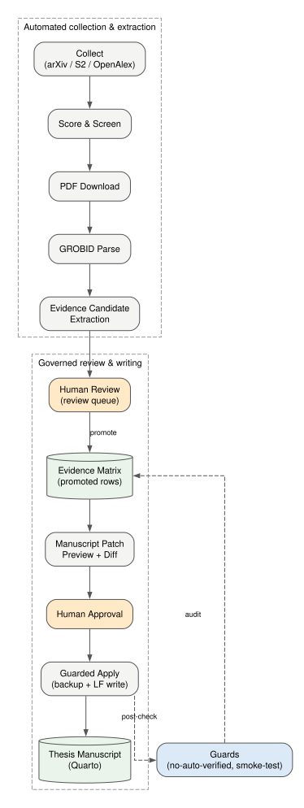
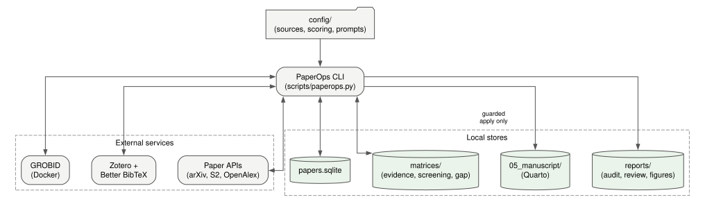
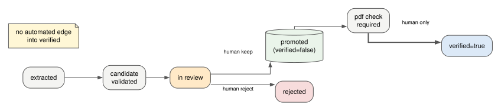
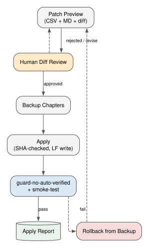

# PaperOps — 证据优先的研究与论文写作操作系统

<details align="right">
  <summary>🌐 Language Translation / 选择语言</summary>
  <br />
  <p>
    <a href="README.md">🇬🇧 English</a> | 
    <a href="README.ko.md">🇰🇷 한국어</a> | 
    <a href="README.de.md">🇩🇪 Deutsch</a> | 
    <a href="README.es.md">🇪🇸 Español</a> | 
    **🇨🇳 中文** | 
    <a href="README.ja.md">🇯🇵 日本語</a> | 
    <a href="README.fr.md">🇫🇷 Français</a> | 
    <a href="README.ar.md">🇸🇦 العربية</a>
  </p>
</details>



PaperOps 通过一个本地优先的 CLI(**50+ 条命令**)自动化**研究写作的全生命周期**:
文献收集、筛选、PDF 解析、证据提取(启发式,以及强制逐字核对引文的 LLM 辅助
提取)、文献库同步、受保护的稿件编辑、可复现的图表生成,以及与实验输出做
数值交叉核对的草稿审计。

它*不是*自动写论文的工具。流水线是自动的,但三个判断点刻意保留给人:
证据采纳、稿件修改批准、`verified=true` 判定。`verified=true` 只能通过
`verify-evidence` 命令、以明确的人工确认(attestation)进入,并记录在验证台账
(verification ledger)中,由 `guard-no-auto-verified` 逐条比对 — 手工修改和
自动化修改都会被守卫判定失败。

## 完整生命周期(分阶段)

| 阶段 | 内容 | 关键命令 | 自动化 |
|---|---|---|---|
| 1. 收集 | 从 arXiv / Semantic Scholar / OpenAlex / Crossref 抓取论文,支持布尔主题查询、polite pool 请求头、429 退避重试与跨来源去重 | `collect`, `digest` | 自动 |
| 2. 分流 | 相关性打分、按研究轴筛选、发现研究空白 | `score`, `screen`, `gap`, `brief` | 自动 |
| 3. 获取 | 下载 PDF,生成论文卡片与提纲 | `download-pdfs`, `cards`, `outline` | 自动 |
| 4. 解析 | 通过 GROBID 将 PDF 转为结构化章节/参考文献 | `parse-grobid`, `validate-grobid-artifacts` | 自动 |
| 5. 提取 | 从解析文本中提取主张/引文/页码证据候选 — 启发式,或由 LLM 提议且每条引文都与原文逐字核验 | `extract-evidence-candidates`, `extract-evidence-llm`, `validate-evidence-candidates` | 自动 |
| 6. 审阅 | 对每个候选做采纳/修改/拒绝决定 | `review-evidence-candidates`, `promotion-plan` | **人工关口** |
| 7. 晋升 | 将批准的证据移入证据矩阵(`verified=false`) | `promote-evidence`, `audit-promoted-evidence` | 受保护 |
| 8. 定位 | 为每条引文找到并记录确切的 PDF 页码 | `locate-pdf-pages`, `apply-page-metadata` | 受保护 |
| 9. 文献库 | 与 Zotero / Better BibTeX 规范 BibTeX 同步 citekey | `sync-zotero`, `check-citekeys` | 自动 |
| 10. 写作 | 以 preview + diff 形式生成稿件补丁 | `manuscript-patch-preview` | 自动 |
| 11. 应用 | 以备份 + SHA 校验 + LF 写入方式应用已批准补丁 | `apply-manuscript-patch` | **人工关口** |
| 12. 图表 | 基于规格的 Graphviz/Mermaid 图表,禁止伪造数据 | `propose-figures`, `render-figures`, `apply-figure-placeholder` | 受保护 |
| 13. 草稿审计 | 检查任意草稿(docx/md/qmd):结构、无来源主张、夸大表述,以及通过 `--experiment-data` 与实验输出文件做数值自动交叉核对 | `audit-manuscript-draft` | 自动 |
| 14. 验证 | 由人设置 `verified=true`,并将确认记录进验证台账;台账中没有对应条目的 verified 行会被守卫判定失败 | `verify-evidence`, `guard-no-auto-verified`, `guard-paperops-overclaim`, `smoke-test` | **人工关口** / 自动守卫 |

## 为什么不直接用聊天 LLM?

| 关注点 | 普通 LLM 聊天/代理 | PaperOps |
|---|---|---|
| 这句话的出处? | 未知 | 证据矩阵中的 `paper_id` + `citekey` + 引文 + 页码 |
| 引用正确性 | 尽力而为 | 与规范 BibTeX 进行 `check-citekeys` 比对 |
| 稿件编辑 | 直接覆盖 | preview → diff → 批准 → SHA 校验应用 → 备份 → 事后审计 |
| "已验证"状态 | 含糊 | 只有 `verify-evidence --attest` 能设置;验证台账 + 守卫会抓出其他一切 |
| 草稿中的数字 | 未核对 | 与真实实验输出文件交叉核对(`audit-manuscript-draft --experiment-data`) |
| 可复现性 | 局限于会话 | SQLite + CSV 矩阵 + 审计报告 + 活动日志 + 图表源文件 |

设计模式来自对 40+ 开源研究工具的调研(PaperQA2、STORM、GPT Researcher、
AI-Scientist、ASReview、gpt_academic、Zotero 生态、MCP 服务器 — 见
`docs/03_TOOL_SYNTHESIS.md`),并围绕一个原则重组:**没有可追溯、经人工
审阅的证据,任何主张都不得进入稿件。**

## 架构



| 组件 | 职责 | 技术 |
|---|---|---|
| `scripts/paperops.py` | 编排所有流水线阶段与守卫的 CLI | Python,标准库优先 |
| `scripts/paperops_figures.py` | 基于规格的图表生成(源文件永久保存) | Graphviz + Mermaid |
| `scripts/paperops_draft_audit.py` | 草稿审计:结构、主张、数值对照 | Python |
| `scripts/build_public_release.py` | 白名单式公开导出 + 密钥/隐私扫描 | Python |
| 论文数据库 | 论文元数据、评分、阅读状态 | SQLite |
| 证据矩阵 | 主张/引文/页码/来源位置/审阅状态/验证字段 | CSV(diff 友好) |
| 稿件 | 论文章节,仅可通过受保护的 apply 修改 | Quarto (.qmd) |
| 外部服务 | PDF 解析;规范文献库 | GROBID (Docker), Zotero + Better BibTeX |

数据单向流动,每个受保护步骤都生成审计报告:
**API → 论文库 → PDF → 解析文本 → 证据候选 → (人) → 证据矩阵 →
补丁 preview → (人) → 稿件**,每次变更后重新运行守卫。



## 快速开始

```bash
git clone https://github.com/SakJaeLim/paperops.git && cd paperops
python -m venv .venv   # Python 3.10+
# Windows: .venv\Scripts\activate | Unix: source .venv/bin/activate
pip install -r requirements.txt
python scripts/paperops.py init
python scripts/paperops.py status
```

然后在 `config/sources.yaml` 的 `openalex_mailto` 中填入你的邮箱 — 它会让
OpenAlex/Crossref 请求进入各自的 polite pool;不填时这两个 API 都会严厉限流
(HTTP 429)。无需外部服务即可使用:收集、打分、筛选、草稿审计、守卫、图表源
生成。可选附加组件:

| 依赖 | 启用功能 | 安装 |
|---|---|---|
| GROBID | PDF → 结构化文本解析 | `docker run -d -p 8070:8070 lfoppiano/grobid:0.8.0` |
| Zotero + Better BibTeX | 规范文献库同步(导出的 `.bib` 文件) | zotero.org + Better BibTeX 插件 |
| Graphviz / Mermaid CLI | SVG/PNG 图表渲染(即使没有它们,源文件也始终会写出) | graphviz.org/download |
| Semantic Scholar API 密钥 | 稳定的 S2 收集(未认证的 S2 限流严重) | `config/sources.yaml` 中的 `semantic_scholar_api_key` |
| `OPENAI_API_KEY` | `extract-evidence-llm`(受保护、强制逐字核对的 LLM 提取;通过 `OPENAI_BASE_URL` 支持任意 OpenAI 兼容端点) | 环境变量 |

## 典型会话

```bash
# 收集与分流
python scripts/paperops.py collect --limit 20
python scripts/paperops.py score && python scripts/paperops.py screen --limit 80

# 解析与证据提取
python scripts/paperops.py download-pdfs --limit 10
python scripts/paperops.py parse-grobid --paper-id <id> --apply
python scripts/paperops.py extract-evidence-candidates --paper-id <id> --apply

# 人工审阅后受保护晋升
python scripts/paperops.py review-evidence-candidates --paper-id <id>
python scripts/paperops.py promote-evidence --paper-id <id> --apply

# 受保护的稿件写作
python scripts/paperops.py manuscript-patch-preview
python scripts/paperops.py apply-manuscript-patch --from-preview <preview.csv> --dry-run
python scripts/paperops.py apply-manuscript-patch --from-preview <preview.csv> --apply

# 审计自己的草稿(docx/md/qmd)— 结构、无来源主张、夸大表述,
# 以及与实验输出文件的数值自动交叉核对
python scripts/paperops.py audit-manuscript-draft --input my_thesis_draft.docx --experiment-data data/experiment_outputs

# 人工验证(核心关口)— 记录进验证台账
python scripts/paperops.py verify-evidence --evidence-id ev_xxxx --by "你的名字" --note "已核对 p.3" --attest

# 图表与最终检查
python scripts/paperops.py render-figures
python scripts/paperops.py guard-no-auto-verified --promoted-only
python scripts/paperops.py smoke-test
```



## 草稿审计实战

`audit-manuscript-draft` 曾用于一篇真实的 KCI 投稿稿件(413 个段落):
扫描 378 个句子、检查章节结构、标记无来源的强主张与夸大表述,并将草稿中
**全部 178 个数值**与真实实验输出文件对照 — 0 个不一致,2 处舍入差异已解释,
1 个基准率从原始预测日志重新计算确认。(当时这项交叉核对是手工完成的;自
v0.2.0 起,`--experiment-data` 参数会自动完成:逐个数值给出精确匹配、舍入
匹配、数据中未找到三种状态。)审计绝不修改草稿,也绝不标记 verified;
只为作者生成发现报告(MD + CSV)。

## 治理规则

1. 证据矩阵不得随意修改;所有重写都是原子的(临时文件 + rename),并附带
   带时间戳的备份。
2. `verified=true` 绝不自动设置。唯一许可的路径是 `verify-evidence --attest`,
   它把由谁、何时、如何验证记录进 `matrices/verification_ledger.csv`;台账中
   没有对应确认的 verified 行,`guard-no-auto-verified` 会判定失败。
3. LLM 提取的候选必须与解析后的原文逐字核对 — 转述或凭空捏造的引文会被丢弃
   并上报 — 之后再走与启发式候选完全相同的人工审阅关口。
4. 引文/页码匹配是*来源对齐*,不是真实性验证。
5. 稿件编辑仅通过受保护的 preview/apply 进行,附带备份(存放在受保护目录树
   之外)、SHA-256 校验,以及事后守卫 + 冒烟测试;批准报告会与当前稿件的
   SHA-256 比对,过期或伪造的报告一律拒绝。
6. 相关工作的发现仅作为设计模式引用,绝不包装为 PaperOps 自身的性能证据。

## 本仓库不包含的内容

仅包含代码、配置、设计文档与生成的图表源文件。出于版权原因,并基于
"证据库应由你自己的文献构建"的原则,刻意排除了:收集的论文 PDF、解析全文、
含引文的证据矩阵、个人稿件章节。导出为白名单制,每次发布前都经过
密钥/隐私扫描(`scripts/build_public_release.py`)。

## 诚实的局限

- LLM 提取器只保证引文是原文逐字;主张/引文的*选取*质量仍然取决于模型,
  而且每一个候选依然需要人工审阅。
- 草稿审计是供人工复核的启发式标记,不是真实性验证;数值交叉核对只确认这些
  数字确实出现在你的数据文件中,并不验证分析本身是否正确。
- 引文/页码对齐不验证主张的真实性 — 这是设计意图。
- 没有真实数据文件,绝不生成定量结果图表。
- 未认证的 Semantic Scholar 收集会被 S2 限流,该来源实际上需要一个免费的
  API 密钥。
- 验证台账能遏制意外的和随手的自动化验证,但它不是密码学机制,拦不住一个
  铁了心的人在自己的本地文件里伪造确认记录。
- 非英文 README 可能比英文版滞后一个版本;以英文 README 和 CHANGELOG 为准。

## 许可证

MIT — 见 [LICENSE](LICENSE)。
